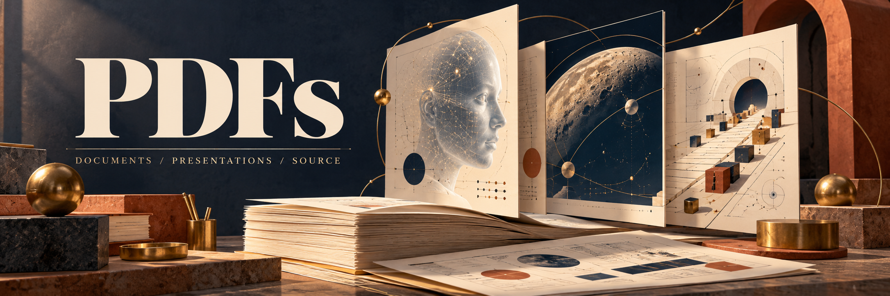
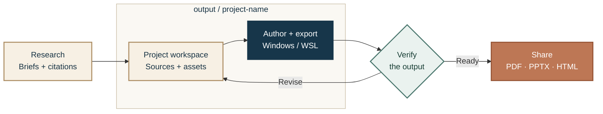

<p align="center">
  <a href="#the-collection"></a>
  <a href="#the-collection"></a>
  <a href="output/"></a>
  <br />
  <a href="AGENTS.md#windows-tools-available-alongside-wsl"></a>
  <a href="AGENTS.md#python-libraries"></a>
  <a href="output/ai-consciousness/source/build-deck.mjs"></a>
  <a href="#toolkit-and-verification"></a>
  <a href="https://github.com/moshehbenavraham/PDFs/commits/main"></a>
</p>

# PDFs

A collection of research-led presentations and the workshop behind them: editable sources, original artwork, finished documents and verification records.

Explore machine consciousness, ambitious technology futures and practical AI-assisted engineering. Open a finished deck, follow its sources, or use the same Windows + WSL workflow to make something new.

**[Explore the collection](#the-collection) · [See the workflow](#from-research-to-a-finished-document) · [Start a project](#start-a-project) · [Read the operating guide](AGENTS.md)**

## The collection

### 01 · Is Anyone Home?

**AI consciousness & sentience · 26 slides · approximately 24 minutes**

A trial of the machine mind: competing theories, thought experiments, audience questions and the practical consequences of uncertainty. The deck has 23 main slides and three optional appendix slides. The offline browser edition adds staged reveals; the PowerPoint remains editable and includes presenter notes.

**[View PDF](output/ai-consciousness/output/Is%20Anyone%20Home.pdf)** · [PowerPoint](output/ai-consciousness/output/Is%20Anyone%20Home.pptx) · [Offline HTML](output/ai-consciousness/output/Is%20Anyone%20Home.html) · [Presenter guide](output/ai-consciousness/output/Presenter%20Guide.pdf) · [Complete ZIP](output/ai-consciousness/output/Is%20Anyone%20Home%20-%20Complete.zip)

[Sources & artwork](output/ai-consciousness/) · [Presentation instructions](output/ai-consciousness/output/START%20HERE.txt)

### 02 · Tomorrow Has Questions

**Machines, moonshots & human purpose · 33 slides**

A field trip through flying cars, clever machines, incentives, alignment and the business of being human. Built around the supplied *Moonshots* conversation, with linked sources and an evidence snapshot dated 20 October 2026.

**[View PDF](output/pdf/tomorrow-has-questions.pdf)** · [Editable source](output/moonshots-tomorrow/source/) · [Artwork](output/moonshots-tomorrow/assets/) · [Visual QA](output/moonshots-tomorrow/qa/)

### 03 · How Anthropic Builds with AI

**A practical engineering playbook · 20 slides · 20 minutes**

Briefs, task selection, verification, review and the human decisions that matter. Eighteen presentation slides are followed by two slides of sources and evidence limits. The research is dated 27 October 2026; team-specific findings retain their scope, and the practical frameworks are adaptations.

**[View PDF](output/anthropic-ai-engineering/how-anthropic-builds-with-ai.pdf)** · [Editable source & artwork ZIP](output/anthropic-ai-engineering/editable-source-and-artwork.zip) · [Build instructions](output/anthropic-ai-engineering/source/README.txt) · [Slide plan](output/anthropic-ai-engineering/source/slide-plan.json)

> To use the offline HTML presentation, download it and open it in a browser. GitHub displays the file's source rather than hosting the presentation.

## From research to a finished document

Keep the evidence, editable source and artwork with the deliverable. Each project has its own build route; review the exported artifact before sharing it.



## Start a project

Clone the workspace, then give each new project its own home under `output/`:

```bash
git clone https://github.com/moshehbenavraham/PDFs.git
cd PDFs
mkdir -p output/my-project/{source,assets,exports}
```

- **`source/`** — research, citations, editable text, layout data and build scripts.
- **`assets/`** — artwork, images and any redistributed fonts with their licenses.
- **`exports/`** — finished PDFs, slide decks, browser editions and bundles.
- **`.build/`** — local intermediates and temporary renders; ignored by Git.

Existing projects retain their established layouts. The Moonshots PDF lives in [`output/pdf/`](output/pdf/), while its source and artwork live in [`output/moonshots-tomorrow/`](output/moonshots-tomorrow/).

For rebuilds, follow the relevant project's source instructions and [AGENTS.md](AGENTS.md). The inventory describes the original Windows/WSL workstation: dependencies and some absolute paths need adjustment on another computer. Cloning this repository does not install the authoring tools.

## Toolkit and verification

The workstation combines programmatic authoring with native desktop tools:

- **Author and assemble:** ReportLab, LibreOffice, TeX, Typst, browser printing, qpdf and PyMuPDF in WSL; Microsoft Office and Inkscape on Windows.
- **Scan and recognize text:** NAPS2 on Windows and OCRmyPDF/Tesseract in WSL, with English, Hebrew and Arabic OCR data installed.
- **Inspect and validate:** Poppler rendering/text/font tools, structural checks, visual review and veraPDF for PDF/A and machine-checkable PDF/UA requirements. Human accessibility review is still necessary.

The [27 October 2026 qualification](output/pdf/windows-tools-2026-10-27/verification.json) covers **Inkscape 1.4.4**, **NAPS2 8.6.0** and **veraPDF 1.30.3**. It includes SVG/PDF round-trip checks, multilingual OCR fixtures, five PDF/A-2b acceptances and one expected rejection. These are local sample results, not a claim that every presentation is archival or accessibility compliant.

**Known OCR limitation:** NAPS2 omitted an Arabic line in both Fast and Best modes; combined Best-mode OCR also changed English words. WSL OCRmyPDF matched all sample lines in its sidecar text. Check each real document, including right-to-left extraction order. Physical scanning was not tested because device enumeration found no scanner.

[Installation receipt](output/pdf/windows-tools-2026-10-27/installation.json) · [Sample renders](output/pdf/windows-tools-2026-10-27/rendered-contact-sheet.png) · [Full tool inventory and commands](AGENTS.md#windows-tools-available-alongside-wsl)

## Keep the workspace tidy

Commit the editable project and useful deliverables together. Preserve originals when making revisions, and inspect the actual exported pages rather than relying on a successful build command.

`.env` and its variants, `.build/`, Python caches and OS metadata are [ignored by Git](.gitignore). Credentials also need to stay out of sources, exported documents and ZIP bundles. The published collection keeps its source citations and bundled font-license files alongside the work.
