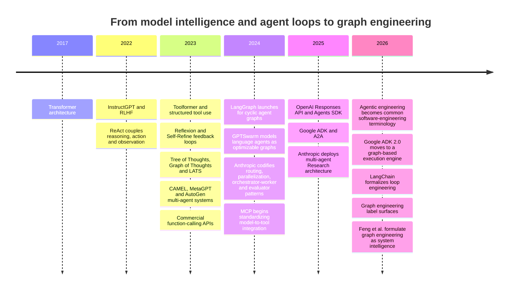

# Graph Engineering and the Shift Beyond Agent Loops

## Executive summary

**Graph engineering is best understood not as the replacement of loops, but as the architectural generalization of them.** A conventional LLM agent is fundamentally a feedback loop: provide state and tools to a model, let it choose an action, observe the result, update state, and repeat until a stopping condition is reached. LangChain's June 2026 formulation called the deliberate design of these nested feedback processes **loop engineering**; its canonical stack includes the inner agent loop, an outer verification loop, event-driven execution, and a still-outer optimization or “hill-climbing” loop. citeturn18search0

By mid-2026, **graph engineering** emerged as a name for a broader systems problem: once useful work requires several agents or agent loops, parallel branches, conditional routing, independent verification, persistent shared state, human checkpoints, and recovery from partial failure, the important design object is no longer one repeated loop. It is the **topology connecting many computational components**. Feng et al.'s August 2026 survey formalized this as engineering explicit, dynamic and potentially evolving graphs over tasks, agents, and runtime state, calling the resulting capability **system intelligence** rather than merely stronger individual-agent intelligence. citeturn17search0turn17search2

The terminology is newer than the architecture. LangGraph was explicitly launched on January 17, 2024 to construct **cyclical graphs for agent runtimes**, and earlier 2023 systems such as AutoGen, MetaGPT, CAMEL, Tree of Thoughts, Graph of Thoughts and LATS were already exploring multi-agent coordination or graph/search structures. LangChain consequently argues that “graph engineering” is a new label for a well-established approach; what *is* genuinely newer is that a graph node can now contain an entire capable agent rather than merely a deterministic function or single LLM call. citeturn19search6turn20view0

There is unusually strong contemporary evidence that this represents an architectural transition rather than only a vocabulary change. Google ADK 2.0, released for Python on May 19, 2026, explicitly changed its runtime from a **hierarchical agent executor to a graph-based execution engine**: agents, tools, and functions became nodes, and graph-based, dynamic, and collaborative workflows became core primitives. citeturn20view1 Anthropic's production research system similarly uses a lead agent that spawns parallel research agents, persistent plan memory, a later citation-verification stage, checkpoints and production tracing; Anthropic reports that this multi-agent configuration outperformed its comparable single-agent configuration by 90.2% on an internal breadth-oriented research evaluation, while also consuming substantially more tokens. citeturn14view1

The principal forces behind the change were therefore not “graphs suddenly became useful.” They were that **models became sufficiently capable of acting as reliable subcomputations**, tool calling and APIs made actions structured, longer contexts and external memory supported long-running execution, reasoning models improved decomposition, multimodality expanded the environments agents can operate in, standard protocols such as MCP and A2A reduced integration friction, and agent evaluation/tracing matured enough to make large non-deterministic systems debuggable. Transformer scaling and instruction-following/RLHF were upstream enablers; ReAct, Toolformer, Reflexion and Self-Refine established action-feedback loops; multi-agent and search-based work introduced branching and delegation; orchestration frameworks turned those ideas into deployable software. citeturn15search0turn15search1turn15search2turn20view2

The most important conceptual correction is:

> **Loop engineering optimizes feedback through time; graph engineering engineers relationships through both time and structure. A loop is itself a cyclic graph, and mature graph systems usually contain many loops.**

Consequently, “loop → graph” should not be interpreted as a clean technology replacement. For open-ended tasks where the next steps genuinely cannot be predicted, a relatively unconstrained agent loop can still be superior to an over-specified graph. LangChain reports that its own deep-research architecture moved in precisely that direction, from a predefined graph toward a more agentic core loop. Graphs are most valuable where developers actually possess useful structural knowledge: required verification, security gates, dependency order, specialist roles, fan-out/fan-in opportunities, transaction boundaries, or recovery points. citeturn20view0

The deeper shift is therefore from **“make one agent smarter and keep it iterating”** toward **“construct a controllable computational organization in which multiple intelligent and deterministic components cooperate.”** That is why the center of engineering gravity is moving from prompts and loops toward topology, state schemas, contracts, scheduling, provenance, distributed evaluation and system-level observability. Feng et al. make essentially this argument, while also stressing that the research evidence is not yet sufficient to establish graph engineering as a universal performance-improving paradigm; stronger models, more token expenditure and better organization are often confounded. citeturn17search0turn17search4

## Terms, architecture, and conceptual boundaries

### Agentic engineering

The term **agentic engineering** does not yet have one universally accepted definition. In the narrower 2026 software-development usage associated with Simon Willison and Martin Fowler, it means professional software engineering **with coding agents**: systems such as Claude Code or Codex that can generate code, execute it, inspect the result and continue iterating rather than merely autocomplete text. Willison reduces the operational core of an LLM agent to “tools in a loop toward a goal”; Fowler emphasizes that the human engineer remains responsible for reviewing and understanding the resulting system, distinguishing agentic engineering from “vibe coding.” citeturn16search0turn16search2turn16search3

For the broader systems discussion in this report, a more useful operational definition is:

**Agentic engineering is the engineering discipline concerned with building, constraining, evaluating and operating software in which model-driven agents can choose actions, invoke tools, modify external or persistent state, adapt to observations and pursue objectives across multiple computational steps with bounded autonomy.**

That broader sense aligns with Anthropic's terminology. Anthropic calls both predefined LLM workflows and dynamically controlled agents “agentic systems,” while distinguishing them architecturally: **workflows** route LLMs and tools through predefined code paths; **agents** let the model dynamically direct its own process and tool use. citeturn13view0 OpenAI similarly described agents in March 2025 as systems that independently accomplish user tasks, and introduced an Agents SDK specifically for single- and multi-agent orchestration plus integrated tracing. citeturn20view2

Agentic engineering therefore spans at least four layers:

**Model intelligence** supplies language, reasoning, perception and learned priors. **Harness engineering** supplies tools, permissions, context management and the runtime surrounding the model. **Loop engineering** structures repeated action, observation and improvement. **Graph engineering** structures the dependencies and coordination among multiple loops, agents, deterministic operations and persistent states. Feng et al. use essentially this progression, with prompt engineering and context engineering preceding the harness/loop/graph layers. citeturn17search0turn17search2

### Loop engineering

At its simplest, an agent loop can be written abstractly as:

\[
s_t
\;\xrightarrow{\text{model/policy}}\;
a_t
\;\xrightarrow{\text{tool/environment}}\;
o_t
\;\xrightarrow{\text{state update}}\;
s_{t+1}
\]

and repeated until a terminal predicate such as `goal_reached`, `budget_exhausted`, `verification_passed`, `human_stop`, or `unrecoverable_failure` becomes true.

The important property is not literally the presence of a `while` statement. It is that **temporal feedback is the dominant organizational primitive**: the same logical decision-making locus repeatedly observes the latest state and chooses what to do next. ReAct's 2022 formulation was a major conceptual precursor, interleaving reasoning traces with actions and observations from an environment rather than treating reasoning as one uninterrupted generation. citeturn1search1 Toolformer showed in 2023 that models could learn when and how to invoke external APIs, while Reflexion and Self-Refine demonstrated iterative feedback and revision without conventional parameter updates on every task. citeturn15search2turn1search2turn12search2

LangChain's 2026 “loop engineering” framing goes further than the inner ReAct-style loop. It describes a stack:

1. the **agent loop**, in which a model repeatedly calls tools;
2. a **verification loop**, in which deterministic or model-based graders reject and feed back bad results;
3. an **event-driven loop**, in which schedules, webhooks or external events continually instantiate work;
4. a **hill-climbing loop**, in which traces and evaluation outcomes are analyzed to improve prompts, tools, graders, memory or potentially model post-training itself. citeturn18search0

Feng et al. give the idea a more formal systems interpretation: loop engineering concerns a bounded, stateful, feedback-driven process that coordinates an agent until its goal is sufficiently supported or further execution is no longer justified. They divide it into loop architecture, interaction paradigm and environment feedback. citeturn17search0turn17search4

A representative loop is therefore:

```text
              ┌─────────────────────────────┐
              │                             │
              ▼                             │
        ┌───────────┐     ┌──────────┐     │
state ─▶│   model   │────▶│   tool   │─────┤
        └───────────┘     └──────────┘     │
              │                             │
              ▼                             │
        ┌───────────┐    fail / continue    │
        │ verifier  │───────────────────────┘
        └───────────┘
              │ pass
              ▼
            done
```

This structure is powerful precisely because it is simple. The model can discover an execution path dynamically instead of the developer enumerating every path in advance. Anthropic explicitly recommends beginning with the simplest viable architecture because agentic complexity adds latency, cost and operational failure modes. citeturn13view0

### Graph engineering

**Graph engineering makes the system topology itself an explicit engineering artifact.** A useful abstract representation is:

\[
G=(V,E,S,C)
\]

where:

- \(V\) contains executable components: deterministic functions, LLM calls, tools, agents, entire internal agent loops, humans, validators or subgraphs;
- \(E\) contains fixed or conditional transitions, communication channels, dependencies and handoffs;
- \(S\) represents explicit runtime state, potentially typed, persistent and versioned;
- \(C\) represents contracts and constraints: schemas, guards, permissions, budgets, invariants, retry rules and completion criteria.

LangGraph's practical definition is very close to this: nodes do work and can contain deterministic code, a single model invocation, tool invocation or complete agent; edges determine what runs next and may be deterministic or conditional; state moves through the graph. LangChain explicitly suggests thinking of this as a state machine. citeturn20view0

Feng et al.'s meaning is broader than a workflow-engine graph. It includes three interlocking structural domains: **task organization**—what depends on what; **agent coordination**—which agent owns or communicates about which work; and **runtime state management**—how execution history, intermediate artifacts and recoverable states are represented. Their proposed mature form includes typed and versioned graph structures, provenance, replay and rollback rather than merely a visual node editor. citeturn17search0turn17search2

A graph may contain all of the following at once:

```text
                    ┌────── specialist A ── verifier A ──┐
                    │                                     │
request ── planner ─┼────── specialist B ── verifier B ──┼─► synthesizer ─► policy gate ─► action
                    │                                     │
                    └────── specialist C ── verifier C ──┘
                                ▲                │
                                └── retry loop ──┘
```

The graph is **not necessarily a DAG**. Production agents need retry cycles, refinement, clarification, approval waits and repeated tool use. LangChain explicitly observes that agent graphs are usually cyclic and that **a loop is simply a particularly small directed cyclic graph**. citeturn20view0

It is equally important to say what this meaning of graph engineering **does not** necessarily imply. It is not synonymous with:

- **knowledge graphs**, which graph facts or entities;
- **graph neural networks**, which operate on graph-structured data;
- **Graph of Thoughts**, which represents candidate reasoning units and their dependencies as a graph;
- generic graph databases;
- a system that happens to retrieve from a graph but whose execution organization is still a single agent loop.

Graph of Thoughts is historically relevant because it made non-linear reasoning structures explicit, but its graph is principally a **reasoning/search representation**, whereas the 2026 graph-engineering concept treats the *agent system itself*—work, agents, state and coordination—as the engineered graph. citeturn12search3turn17search0

### The essential relationship

The relationship is therefore hierarchical rather than adversarial:

\[
\text{prompt}
\subset
\text{context}
\subset
\text{harness}
\subset
\text{loop}
\subseteq
\text{graph-based system}
\]

That expression is conceptual rather than a formal set-theoretic claim: a sophisticated system may mix these layers in many ways. The point is that graph engineering generally **retains** the loop. A graph node may itself execute a coding agent for hundreds of tool calls before returning a typed result to another node. LangChain identifies this compositional change—whole agents becoming nodes—as the strongest substantive justification for the new terminology. citeturn20view0

## How the transition happened

The transition is easier to understand as a sequence of changing **engineering bottlenecks** rather than a sequence in which one paradigm became obsolete.

In the first phase, the bottleneck was **model capability**: better architectures, more training compute and post-training were needed. The 2017 Transformer supplied a highly scalable attention-based architecture; instruction fine-tuning and RLHF, exemplified by InstructGPT in 2022, substantially improved the ability of language models to follow human intent. These developments were prerequisites for reliable agent control but were not themselves agent orchestration techniques. citeturn15search0turn15search1

The next bottleneck was **interaction with environments**. ReAct, posted in October 2022, coupled reasoning with environment actions and observations. Toolformer, published in 2023, addressed learned API invocation. OpenAI's 2023 function-calling interface supplied developers with a structured model-to-software boundary based on declared functions and arguments. Together, such techniques turned LLM output from predominantly prose into a source of machine-actionable decisions. citeturn1search1turn15search2turn15search3

Then came **self-correction and search**. Reflexion and Self-Refine treated feedback as something the model could consume on subsequent iterations; Tree of Thoughts explored alternative reasoning branches and backtracking; Graph of Thoughts generalized reasoning dependencies beyond trees; LATS combined LLM reasoning/action with Monte Carlo Tree Search-style exploration, value estimates, reflection and environment feedback. These systems made it clear that one straight chain of tokens was not the only useful inference-time structure. citeturn1search2turn12search2turn1search3turn12search3turn12search1

At almost the same time, **multi-agent organization** became a major research direction. CAMEL explored role-playing cooperative agents; MetaGPT encoded software-development standard operating procedures into role-based multi-agent work; AutoGen exposed multiple customizable “conversable” agents as a reusable framework. These systems shifted the unit of design from one conversation to interactions among several computational roles. citeturn10search2turn10search1turn10search0

LangGraph's January 2024 launch then made the execution structure explicit as **cyclic state graphs**, specifically because ordinary chains were insufficient for agent runtimes. Its later runtime work added checkpointing, parallel execution, interrupts and state-centric debugging. citeturn19search6turn19search8 In February 2024, GPTSwarm's *Language Agents as Optimizable Graphs* independently described LLM agents as computational graphs whose nodes process multimodal data or call LLMs, whose edges carry information, and whose connectivity could itself be optimized. citeturn17academia11

By late 2024, what Anthropic called production “agentic systems” were already naturally decomposed into graph-like patterns: prompt chains, routers, parallel branches, orchestrator-worker structures and evaluator-optimizer cycles. Anthropic's December 2024 engineering guidance did not call this graph engineering, but the topology is unmistakably graph-structured. citeturn13view0

In 2025 the orchestration substrate matured. OpenAI released the Responses API, built-in web/file/computer tools, Agents SDK and integrated tracing in March 2025 to simplify multi-step single- and multi-agent applications. Google's Agent Development Kit and Agent2Agent initiative pushed reusable agent construction and inter-agent communication, while MCP standardized connections from AI applications to external tools and data. citeturn20view2turn11search0turn10search3

Anthropic's June 2025 production research system is an especially revealing midpoint. It defines a lead researcher that saves a plan to persistent memory, dynamically creates parallel subagents, allows those subagents to run their own search loops, rejoins their outputs, optionally spawns more work, and finally passes the result to a dedicated CitationAgent. This is exactly the pattern by which **loops become graph nodes** and system topology becomes a first-class concern. citeturn14view1

In 2026 the architectural reality acquired names. “Agentic engineering” became widely used in professional software-development discourse early in the year. Google ADK 2.0 made its graph runtime explicit in May. LangChain published “The Art of Loop Engineering” on June 16, then “3 Years of Graph Engineering with LangGraph” on July 22. Feng et al. submitted their survey on August 21 and proposed Graph Engineering as the next systems-level layer after prompt, context, harness and loop engineering. citeturn16search0turn20view1turn18search0turn20view0turn17search0



The exact emergence of terminology should not be confused with the emergence of the underlying methods. LangChain itself says the “graph engineering” label surfaced only in July 2026 while emphasizing that it had been representing agents as graphs for years; Feng et al.'s later survey packages a much broader research lineage under the new term. Thus the timeline supports a **gradual architectural convergence followed by a rapid naming convergence**, not an abrupt scientific paradigm change in summer 2026. citeturn20view0turn17search0

## Technical forces behind the shift

**Model capability crossed the “useful node” threshold.** Early LLM orchestration often used one LLM call per stage because an individual invocation was not dependable enough to own a substantial subproblem. LangChain's retrospective argues that the genuinely new development is that a node can now be a complete, long-running agent. OpenAI likewise tied the rise of production agents to improvements in reasoning, multimodal interaction and safety before releasing its 2025 agent stack. citeturn20view0turn20view2

**Tool use turned language models into controllers.** Toolformer demonstrated learned API-use decisions, while commercial function calling exposed tools through structured schemas. Once actions can be represented as typed operations rather than parsed prose, edges between “reasoning” and software services become much more robust. citeturn15search2turn15search7 MCP pushes this abstraction further by standardizing how AI applications connect to tools, external systems and contextual resources, reducing the cost of giving different graph nodes different capabilities. citeturn10search3

**Feedback made the loop useful, but specialization exposed its limit.** Reflexion and Self-Refine showed that iterative critique can materially improve outputs without retraining model parameters. Yet an agent that writes and then judges its own work suffers from correlated errors and weak independence. Anthropic's production patterns explicitly separate generators from evaluators and sometimes run several model instances independently for voting, guardrails or code review. Feng et al. identify heterogeneous expertise and independent verification as reasons one individual-agent organization becomes inadequate. citeturn1search2turn12search2turn13view0turn17search0

**Parallelism became a performance primitive.** A single loop serializes work unless its internal tool calls deliberately fan out. A graph can expose independent branches directly and later join them. Anthropic reports that its production Research system moved from sequential searching toward parallel subagents and parallel tool calls, reducing elapsed research time by as much as 90% for complex queries in its own system. It also reports a large internal quality advantage for a multi-agent configuration on breadth-oriented research. These are vendor-reported system measurements rather than independent universal benchmarks, and Anthropic explicitly warns that multi-agent systems consume much more computation and are poor fits for tightly coupled tasks. citeturn14view1

**Separate context windows became a scaling resource.** In multi-agent research, each worker obtains an independent context in which to investigate one branch before compressing findings back to the orchestrator. Anthropic's analysis says token use alone explained much of the variance in one browsing evaluation, making clear that some apparent “multi-agent intelligence” is in fact additional inference-time compute. This is one of the strongest reasons to be cautious about claims that topology itself produces the improvement. citeturn14view1

**Memory evolved from conversation history into explicit state.** In a simple loop, the transcript itself can approximate state. Long-running systems need more: plans, artifacts, task ownership, intermediate decisions, external side effects, checkpoints and long-term memory. Anthropic persists its lead research plan because context may be truncated; LangGraph exposes persisted state and checkpoints; Feng et al. argue for versioned runtime-state graphs, provenance, replay and rollback. citeturn14view1turn19search8turn17search0

**Reasoning and planning shifted from one hidden trajectory toward structured decomposition.** Tree of Thoughts and LATS demonstrated explicit search over alternative futures; orchestrator-worker systems let an LLM generate the work decomposition dynamically; graph runtimes combine those dynamic choices with known structural constraints. The result is not purely hard-coded workflow and not purely autonomous planning: it is a **mixed-initiative topology** in which some edges are fixed and others are created or selected at runtime. citeturn1search3turn12search1turn13view0turn20view0

**Multimodality enlarged the action surface.** Agent platforms increasingly combine textual reasoning with web search, document retrieval, computer use and other modalities. OpenAI explicitly cited advanced reasoning and multimodal interaction as capabilities enabling its agent platform, and its Responses API was built around multiple integrated tools. A larger and more heterogeneous action space makes specialization, capability boundaries and explicit routing increasingly valuable. citeturn20view2

**RLHF was an enabler, not the architectural cause.** InstructGPT's supervised instruction fine-tuning plus reinforcement learning from human feedback improved instruction following and alignment relative to the underlying GPT-3 model, helping make natural-language control interfaces more dependable. But graph engineering happens primarily at **inference and systems architecture time**: it changes which components execute, communicate and verify one another. A graph can use RLHF-trained, preference-optimized, RL-trained or even non-LLM components interchangeably. citeturn15search1turn17search0

**Interoperability reduced coupling.** MCP focuses on agent/model access to tools and context; A2A targets communication between distinct agents; ordinary HTTP APIs, queues, event buses and databases remain equally important. These interfaces make it increasingly plausible to treat agents from different stacks, models or organizations as replaceable graph nodes rather than building one monolithic process. Google's ADK 2.0 architecture reflects that modularization by treating agents, tools and functions uniformly as workflow nodes. citeturn10search3turn11search0turn20view1

**Evaluation and tracing finally made system structure operable.** A single-turn model can often be tested by comparing output to a target. Agents generate trajectories involving many model calls, tool invocations and state mutations; Anthropic therefore distinguishes the transcript from the ultimate environment outcome and recommends combining deterministic, model-based and human graders. The more branches and agents a system contains, the more important causal traces, node-level metrics and outcome-based evaluation become. citeturn13view1

A useful synthesis is that graph engineering became attractive once three thresholds were crossed simultaneously:

\[
\text{capable nodes}
+
\text{structured interfaces}
+
\text{observable runtime}
\;\Longrightarrow\;
\text{engineerable multi-agent topology}
\]

No single paper caused that transition. It emerged from the interaction of model quality, post-training, tool interfaces, external memory, parallel compute, orchestration runtimes and evaluation infrastructure. citeturn15search1turn15search2turn20view0turn13view1

## What changes in engineering practice

The following table captures the architectural distinction. These are **typical tendencies, not absolute constraints**; because loops are graphs and graph nodes can themselves be loops, there is deliberate overlap. The comparison synthesizes LangChain's loop/graph descriptions, Anthropic's production patterns and Feng et al.'s systems taxonomy. citeturn18search0turn20view0turn14view1turn17search0

| Dimension | Loop engineering | Graph engineering |
|---|---|---|
| **Primary design object** | Repeated agent/environment feedback process | Explicit topology of tasks, agents, state and transitions |
| **Canonical form** | `observe → reason → act → observe → …` | Nodes + edges + graph state + routing/transition rules |
| **Control locus** | Usually one principal agent/controller | Distributed among deterministic logic, routers, agents, validators and humans |
| **Topology** | Usually implicit or compact | Explicit and inspectable |
| **Cycles** | Fundamental | Fully supported; loops are cyclic subgraphs |
| **Branching** | Usually chosen inside the controller loop | Represented directly as conditional edges/routes |
| **Parallelism** | Possible, but often embedded within a turn | First-class fan-out/fan-in pattern |
| **Specialization** | Tools or subagents selected by one main loop | Dedicated agent/node roles with explicit boundaries |
| **State** | Often transcript/context plus harness state | Shared or partitioned typed state, artifacts, checkpoints and provenance |
| **Verification** | Self-check or outer verifier loop | Independent verifier nodes, voting branches, policy gates, CI/tests |
| **Failure boundary** | Often the whole run or latest tool step | Node/subgraph boundary; retries and recovery can be localized |
| **Recovery** | Re-enter loop, re-prompt or restart | Resume checkpoint, retry node, compensate, reroute, replay or roll back |
| **Determinism** | Model chooses much of the trajectory | Developer can decide exactly where determinism ends and model judgment begins |
| **Observability unit** | Turn, tool call and trajectory | Node, edge, state transition, branch, subgraph and end-to-end trajectory |
| **Scaling strategy** | More turns, tools, context or stronger model | More/heterogeneous workers, parallel branches, specialist services and subgraphs |
| **Testing focus** | “Can this agent eventually solve the task?” | “Do nodes, transitions, invariants and final outcomes all behave correctly?” |
| **Deployment unit** | Agent/harness | Versioned graph plus node implementations/state schema |
| **Ideal task shape** | Open-ended sequential exploration where next step is difficult to predict | Partially structured tasks with known dependencies, parallelism, gates or specialized roles |
| **Main failure mode** | Wandering, correlated self-evaluation, context pollution, long serial trajectories | Coordination bugs, stale/shared state, routing errors, race conditions, topology explosion |
| **Main cost risk** | Excess turns and context growth | Fan-out multiplying model calls, state and coordination overhead |
| **Human role** | Interrupt or review the loop | Explicit approval/review node or guarded transition |
| **Architectural metaphor** | Feedback controller | State machine/workflow/dataflow/distributed organization |

### Design patterns

Several patterns become particularly natural in graph-oriented systems.

**Router → specialist** assigns work based on classification or capability. Anthropic identifies routing as a standard production workflow because specialized downstream prompts or tools can be optimized independently. citeturn13view0

**Planner → parallel workers → reducer** first decomposes work, executes independent branches concurrently, then synthesizes the result. Anthropic's Research system and the generic orchestrator-worker pattern are canonical examples. citeturn13view0turn14view1

**Generator → independent evaluator → retry/commit** structurally separates proposal and judgment. This is the graph generalization of the evaluator-optimizer loop and is preferable when verification should not share the exact cognitive trajectory that generated the proposal. citeturn13view0turn17search0

**Agent → deterministic gate → side effect** places security, authorization, schema validation, financial limits or human approval between a stochastic proposal and an irreversible action. LangChain specifically argues that graph structure lets developers decide where model judgment is permitted and where deterministic behavior must be enforced. citeturn20view0

**Map → reduce**, **scatter → gather**, and **committee → judge** turn inference-time compute into an explicit scheduling choice. Dynamic graphs are important here because the number of workers may depend on the task and cannot always be statically enumerated. citeturn20view0

**Hierarchical graph/subgraph composition** encapsulates a whole agent team behind one node contract. This is the important 2026 compositional step: a node can contain an agent loop, which may itself spawn subagents and use tools. citeturn20view0

### Developer workflow

Loop-centric development tends to optimize an agent's prompt, tool descriptions, context and stopping conditions by inspecting trajectories. Graph-centric development adds a second artifact: the developer must explicitly model **states and transitions**. That encourages interfaces such as `ResearchRequest → EvidenceBundle` or `PatchCandidate → VerifiedPatch` rather than allowing every component to mutate one undifferentiated conversation. Google ADK 2.0's change from `BaseAgent` execution to agents as `BaseNode` instances is an unusually literal example of this architectural shift. citeturn20view1

That changes code review as well. A reviewer can ask not only “is this prompt good?” but “can an unverified value reach the payment node?”, “what happens if worker C times out?”, “can these two branches update the same state?”, “which graph version produced this side effect?”, and “does every transition preserve the state schema?” Those questions resemble distributed-systems and workflow-engineering review more than classic prompt engineering. This is an inference from the graph/runtime requirements emphasized by LangGraph, Google ADK and Feng et al. citeturn20view0turn20view1turn17search0

### Testing and verification

The natural testing hierarchy becomes:

**Node tests** check deterministic functions, tool adapters and agent contracts. **Edge/routing tests** check which transitions are possible under known states. **Invariant tests** ensure forbidden states or actions cannot be reached. **Subgraph tests** evaluate coherent capabilities such as research or code review. **End-state tests** examine what actually changed in the external environment. **Trajectory evaluations** inspect efficiency, tool selection, policy adherence and pathological behavior. **Stochastic regression suites** run repeated trials because identical inputs can produce different trajectories. This hierarchy follows from modern agent-evaluation practice, where transcripts, environmental outcomes and several grader types are evaluated separately. citeturn13view1

For coding agents, deterministic verification is unusually powerful because generated patches can be compiled, type-checked, linted, security-scanned and subjected to test suites. Anthropic's agent-evaluation guidance explicitly recommends stable task environments and outcome-oriented tests; its 2026 C-compiler experiment similarly found that high-quality test infrastructure and CI were crucial for keeping autonomous agents on task. citeturn13view1turn14view0

### Safety and robustness

Graphs provide a powerful **control surface**, but not an automatic safety proof. They can make dangerous transitions explicit; segregate privileges; insert policy, schema or human-approval gates; isolate workers; constrain tools by role; and ensure that proposed changes pass independent verification before commitment. LangChain describes this developer-imposed structure as one of the central reasons to represent agents as graphs. citeturn20view0

The architecture also improves fault containment. Rather than restart a long, expensive agent trajectory, a durable graph runtime can checkpoint progress and retry or resume the affected portion. Anthropic says its production research system combines model adaptability with deterministic retries and checkpoints because stateful multi-agent work is too expensive to simply restart after every failure. citeturn14view1

But a graph can **amplify** risk as well. A compromised or hallucinating upstream node may poison many downstream branches; additional agents expand the tool and prompt-injection attack surface; shared mutable state can create race and integrity problems; a faulty router can systematically send work to the wrong privilege domain; and parallel execution can multiply the speed of a harmful action. The appropriate conclusion is therefore not “graphs are safer,” but **graphs expose more places where safety boundaries can be engineered and audited**. That is a systems advantage, not a guarantee. citeturn17search0turn14view1

### Scalability and economics

Graph architecture offers two forms of scalability: **horizontal reasoning parallelism**, where workers independently process branches, and **organizational scalability**, where capabilities are isolated behind stable contracts and can be developed or replaced separately. Anthropic's Research system shows the upside and the economic cost: its multi-agent design was much more effective on highly parallelizable research tasks but reportedly consumed around 15 times the tokens of ordinary chat interactions, and Anthropic explicitly says tightly coupled tasks may not benefit. citeturn14view1

This suggests a practical rule:

\[
\text{Use graph fan-out when}
\quad
\text{value of independence + parallelism}
>
\text{coordination + token + latency cost}.
\]

Graphs should therefore support **budgets as first-class state**: maximum agents, tool calls, wall-clock time, tokens, retries and monetary spend. This recommendation follows directly from reported multi-agent resource amplification and the dynamic-worker patterns used in production systems. citeturn14view1turn20view0

### Observability and deployment

Loop observability asks, “what did the agent do?” Graph observability must additionally answer **where, why and through which dependency** a result or failure propagated. Full traces need node identity, graph version, parent/child relationships, edge decisions, state deltas, model/tool versions, latency, cost and side-effect identifiers. Anthropic reports that full production tracing was necessary to distinguish failures caused by bad search queries, poor source choice and tool errors in its Research system. citeturn14view1

Graph state also complicates deployment. If an agent can run for hours, a deployment may occur while thousands of executions occupy different graph nodes. Anthropic describes its production system as a highly stateful web of prompts, tools and execution logic and says it uses gradual deployment techniques so code changes do not invalidate in-flight runs. citeturn14view1 Google ADK 2.0 illustrates the schema-versioning problem concretely: its graph runtime added node information and workflow output fields to persisted events, requiring schema changes for certain custom persistence implementations. citeturn20view1

The production-grade abstraction is therefore closer to:

\[
\text{graph version}
+
\text{node versions}
+
\text{state schema}
+
\text{tool/API versions}
+
\text{checkpoint}
+
\text{trace}
\]

than to “prompt + model name.”

## Representative systems and case studies

| System / work | Why it matters to the loop → graph transition |
|---|---|
| **ReAct — Yao et al., 2022/2023** citeturn1search1 | Canonical precursor to the agent loop: reasoning and actions are interleaved with environment observations, making iterative model-environment feedback explicit. |
| **Reflexion — Shinn et al., 2023** citeturn1search2 | Adds linguistic reflection and episodic feedback, showing how a loop can adapt across attempts without gradient-based model retraining. |
| **Self-Refine — Madaan et al., 2023** citeturn12search2 | Demonstrates generator-feedback-refinement iteration using the model itself; an important precursor to verification loops. |
| **Tree of Thoughts — Yao et al., 2023** citeturn1search3 | Replaces one linear reasoning trajectory with branching candidate states, evaluation and search/backtracking. It is graph-adjacent reasoning, not yet system-level graph engineering. |
| **Graph of Thoughts — Besta et al., 2023** citeturn12search3 | Generalizes inference-time thought dependencies beyond chains/trees, including merging and cycles. Important intellectual precursor, but its graph represents reasoning units rather than a whole multi-agent runtime. |
| **LATS — Zhou et al., 2023** citeturn12search1 | Combines environment interaction, reflection, value estimation and Monte Carlo Tree Search, illustrating how agent behavior can become an explicit search topology. |
| **CAMEL — Li et al., 2023** citeturn10search2 | Early role-playing multi-agent framework demonstrating cooperation between specialized language agents. |
| **MetaGPT — Hong et al., 2023** citeturn10search1 | Models software development through specialized roles and standard operating procedures; an early example of making organizational structure part of the AI system. |
| **AutoGen — Microsoft Research, 2023** citeturn10search0 | General-purpose framework for applications made of multiple conversable agents. It helped move agent design from one autonomous loop toward agent-to-agent coordination. |
| **LangGraph — LangChain, January 2024** citeturn19search6 | One of the clearest practical bridges: explicitly launched to construct cyclic graphs for agent runtimes, with state and customizable control flow. |
| **GPTSwarm / Language Agents as Optimizable Graphs — Zhuge et al., February 2024** citeturn17academia11 | Represents LLM agents as computational graphs and optimizes both node prompts and graph connectivity, directly anticipating the later “graph engineering” language. |
| **Anthropic agentic workflow patterns — December 2024** citeturn13view0 | Codifies prompt chaining, routing, parallelization, orchestrator-workers and evaluator-optimizer structures. Collectively they form the basic graph-design vocabulary used in production agent systems. |
| **OpenAI Responses API and Agents SDK — March 2025** citeturn20view2 | Productizes tool use, single/multi-agent orchestration and tracing. Shows the platform layer evolving from “model API” toward “agent runtime primitives.” |
| **Anthropic Research multi-agent system — June 2025** citeturn14view1 | Production orchestrator-worker graph: persistent plan, parallel worker loops, dynamic delegation, synthesis, separate citation agent, checkpoints and tracing. Particularly strong evidence for the architectural argument. |
| **Google ADK 2.0 — May 2026 onward** citeturn20view1 | Explicitly changes ADK from hierarchical agent execution to a graph-based runtime where agents, tools and functions are nodes. This is perhaps the most literal commercial-framework example of the shift. |
| **Anthropic parallel C-compiler experiment — February 2026** citeturn14view0 | Sixteen parallel Claude instances worked through almost 2,000 sessions on a shared compiler project. The experiment exposed both the benefits of specialization/parallelism and the coordination problems when subtasks cease to be independent. |
| **The Art of Loop Engineering — LangChain, June 2026** citeturn18search0 | Gives the emerging loop paradigm an explicit vocabulary: agent, verification, event-driven and self-improvement loops. |
| **Three Years of Graph Engineering with LangGraph — LangChain, July 2026** citeturn20view0 | Makes the key counterargument to hype: graph engineering is not fundamentally new; loops are simple graphs. It identifies full agents-as-nodes as the important recent change. |
| **Graph Engineering in the Era of LLM Agents — Feng et al., August 2026** citeturn17search0turn17search2 | First major survey explicitly organizing the field around “Graph Engineering,” proposing task, agent and state graphs as the substrate for system intelligence. |

Two case studies deserve closer analytical attention.

**Anthropic Research illustrates the success case.** Research naturally contains independent information-gathering branches. A lead agent can decompose a query, send different directions into independent context windows, allow each worker to run its own search loop and then recombine the compressed evidence. Anthropic's reported improvements are therefore consistent with both architectural advantage and increased inference-time compute. Crucially, the same source reports where this approach does *not* work well: tasks with tight interdependencies and shared context reduce the benefits of parallel agents. citeturn14view1

**Anthropic's C-compiler experiment illustrates the limit.** When many independent compiler tests failed, multiple agents could efficiently work on separate bugs. Once all agents encountered the same Linux-kernel compilation bottleneck, sixteen workers repeatedly collided on the same problem and parallelism ceased to help. The researchers had to restructure the evaluation environment to create separable work units. This is graph engineering in a deeper sense: **parallel agent count is not the resource; decomposable topology is**. citeturn14view0

That example leads to an important engineering principle:

> **A good multi-agent graph does not merely add nodes. It creates useful conditional independence between nodes.**

Without that property, the graph can become an expensive distributed version of one confused loop.

## Open questions and research outlook

The largest unresolved issue is **causal attribution**. If a 10-agent graph beats a single agent while using ten times the tokens and more tool calls, how much improvement came from topology, how much from additional test-time compute, and how much from simply having more independent samples? Anthropic's own research measurements show strong relationships between token expenditure and performance, while Feng et al. explicitly call for structural ablations, intervention studies and trace analysis to isolate organizational gains from stronger models or larger compute budgets. citeturn14view1turn17search0

A second question is **how much topology should be static**. Hard-coded graphs improve predictability, but excessive structure can prevent capable models from discovering better strategies. LangChain offers a particularly useful counterexample: generic deep research proved sufficiently open-ended that it moved away from an overly predefined graph toward an agentic core loop. The likely long-term architecture is therefore neither “all edges written by developers” nor “model decides everything,” but a constrained dynamic graph: fixed safety and invariant boundaries around model-selected or model-generated execution paths. citeturn20view0

A third problem is **graph synthesis**: who designs the graph? Today the developer usually specifies much of the topology. GPTSwarm already explored optimization of graph connectivity, and current systems can dynamically create workers. A natural next step is systems that compile a goal, policies, resource budget and available capabilities into a candidate execution graph before or during execution, then optimize that graph from evaluation traces. Whether such topology optimization can be made robust enough for production remains open. citeturn17academia11turn20view0

A fourth problem is **semantic contracts between agents**. Schemas can establish that a node returns `Evidence[]`, but not necessarily what counts as sufficient evidence, whether confidence scales are calibrated across agents, or whether two specialized agents mean the same thing by “verified.” Feng et al. consequently extend their roadmap beyond graph engineering toward ontology engineering—a shared machine-interpretable semantic layer for system components. citeturn17search2

A fifth problem is **state consistency**. Once several agents concurrently read and update shared state, familiar distributed-systems issues return: lost updates, stale reads, races, duplicate side effects, idempotency, transaction isolation and conflict resolution. The graph abstraction helps expose these relationships, but it does not solve them. Feng et al.'s interest in structural transactions, persistent provenance, replay and rollback is therefore more than bookkeeping: agent engineering is converging with workflow engines, databases and distributed systems. citeturn17search0

A sixth is **evaluation under path diversity**. For a graph containing autonomous agents, there may be hundreds of acceptable trajectories to the same outcome. Anthropic explicitly notes that multi-agent systems may take completely different valid paths from identical starting conditions, which makes exact trajectory matching inappropriate. The emerging answer is to evaluate final environmental state plus safety/process constraints and use traces diagnostically rather than demand one canonical path. citeturn14view1turn13view1

A seventh is **independence versus correlated failure**. Multiple agents based on the same foundation model, prompts and evidence are not truly independent evaluators. Voting among five highly correlated model instances may provide less assurance than one deterministic checker, one differently prompted critic and one external test oracle. Research still needs better ways to quantify error correlation and choose heterogeneous verification topologies. The motivation for independent verification is explicit in current graph-engineering literature, but the optimal composition remains unresolved. citeturn17search0turn13view0

An eighth is **security composition**. Tool-connected agents can encounter hostile content, and graph fan-out increases the number of trust boundaries. Future runtimes will need capability security, taint/provenance tracking, least privilege, trusted/untrusted state separation, transaction approval and explicit information-flow policy—not merely prompt-level instructions. This follows from the increasing prevalence of tool-using, state-mutating systems described by OpenAI, Anthropic and the graph-engineering survey. citeturn20view2turn14view1turn17search0

A ninth is **economic optimality**. Multi-agent execution can improve quality but may multiply tokens, model calls and latency. The optimal architecture is therefore task- and price-dependent. Routing a simple question through seven frontier-model agents is structurally sophisticated but economically irrational. Anthropic's recommendation to use agents only when increased complexity earns its cost remains an important counterweight to the graph-engineering trend. citeturn13view0turn14view1

Finally, the terminology itself remains uncertain. “Graph engineering” may persist as a field name, or it may eventually dissolve into established language from **workflow orchestration, state machines, distributed systems, actor systems, dataflow programming and multi-agent systems**. The underlying shift is much less uncertain than the label: production agent systems increasingly require explicit control over relationships among stochastic and deterministic computations. LangChain itself characterizes the new term as a buzzword naming a real pre-existing engineering challenge, while Feng et al. deliberately frame it as an *emerging* paradigm rather than an already settled discipline. citeturn20view0turn17search0

## Further reading

The following sequence is ordered to reconstruct the conceptual transition from model capability, through looping agents, to explicit multi-agent graphs. Primary papers and official engineering sources are prioritized.

**Foundations.** Vaswani et al., *Attention Is All You Need* establishes the Transformer architecture underlying modern LLMs. Ouyang et al., *Training Language Models to Follow Instructions with Human Feedback*, is the canonical InstructGPT/RLHF reference for instruction-following post-training. citeturn15search0turn15search1

**The basic action loop.** Yao et al., *ReAct: Synergizing Reasoning and Acting in Language Models*, is the most important conceptual starting point for understanding the modern think/act/observe agent cycle. Schick et al., *Toolformer*, then shows language models learning when and how to invoke external APIs. citeturn1search1turn15search2

**Feedback and self-improvement.** Shinn et al., *Reflexion* and Madaan et al., *Self-Refine* are useful for understanding why “run once” gave way to repeated critique and revision. citeturn1search2turn12search2

**Non-linear inference.** Yao et al., *Tree of Thoughts*; Besta et al., *Graph of Thoughts*; and Zhou et al., *Language Agent Tree Search* show three progressively richer ways of making branching, search and feedback explicit at inference time. They should be read as intellectual precursors rather than as identical to system-level graph engineering. citeturn1search3turn12search3turn12search1

**Early multi-agent organization.** CAMEL, MetaGPT and Microsoft's AutoGen show the 2023 move from one agent trajectory toward specialized roles, cooperative interaction and reusable multi-agent frameworks. citeturn10search2turn10search1turn10search0

**Explicit computational graphs.** LangChain's original January 2024 *LangGraph* announcement is valuable precisely because it predates the 2026 terminology and states plainly that agent runtimes require cyclical graphs. Zhuge et al.'s *Language Agents as Optimizable Graphs* is an especially important academic complement because it explicitly represents agents as computational graphs and considers optimizing their connectivity. citeturn19search6turn17academia11

**Production architecture patterns.** Anthropic's December 2024 *Building Effective Agents* remains one of the clearest primary-source treatments of prompt chaining, routing, parallelization, orchestrator-workers, evaluator-optimizer loops and autonomous agents. It is useful because it also argues against unnecessary complexity. citeturn13view0

**Agent infrastructure.** OpenAI's *New Tools for Building Agents* documents the March 2025 transition from bare model APIs toward integrated tools, orchestration and tracing. MCP's official specification/resources and Google's A2A materials are the relevant primary references for tool and inter-agent interoperability. citeturn20view2turn10search3turn11search0

**A production multi-agent graph.** Anthropic's *How We Built Our Multi-Agent Research System* is arguably the best concrete production case study to read after the architectural papers because it covers decomposition, worker fan-out, persistent memory, dynamic replanning, citation verification, evaluation, checkpointing, tracing, cost and deployment problems in one system. citeturn14view1

**A stress test of parallel agents.** Nicholas Carlini's *Building a C Compiler with a Team of Parallel Claudes* is unusually informative because it reports both what parallel agent teams can achieve and exactly where parallelism stops helping when the underlying work graph lacks independent branches. citeturn14view0

**Evaluation.** Anthropic's January 2026 *Demystifying Evals for AI Agents* provides a practical taxonomy of tasks, trials, graders, transcripts, outcomes and evaluation harnesses, and explains why long-running tool-using agents require more than single-output benchmark scoring. citeturn13view1

**The terminology itself.** LangChain's June 2026 *The Art of Loop Engineering* should be read immediately before its July 2026 *3 Years of Graph Engineering with LangGraph*. Together they make the crucial conceptual point: nested loops are valuable, but loops are themselves graph structures, and graphs become increasingly useful once entire agents can be composed as nodes. citeturn18search0turn20view0

**The formal survey.** Feng et al., *Graph Engineering in the Era of LLM Agents: From Individual Intelligence to System Intelligence*, submitted in August 2026, is currently the most direct primary academic source for the term. Its accompanying curated repository extends the taxonomy across task organization, agent coordination, runtime state, system evolution, benchmarks and ontology engineering. It should be treated as an ambitious framing of an emerging field, not as proof that every agent application ought to become multi-agent or graph-heavy. citeturn17search0turn17search2

The resulting intellectual trajectory is compactly summarized as:

\[
\boxed{
\begin{array}{c}
\text{LLM} \\
\downarrow \\
\text{instruction-following model} \\
\downarrow \\
\text{tool-using agent} \\
\downarrow \\
\text{feedback loop} \\
\downarrow \\
\text{verified / memory-bearing loop} \\
\downarrow \\
\text{specialized parallel agents} \\
\downarrow \\
\text{explicit task + agent + state graph} \\
\downarrow \\
\text{versioned, observable, recoverable agent system}
\end{array}
}
\]

The key engineering lesson is that the final step is **not “replace autonomous agents with workflows.”** It is to treat autonomy as one computational primitive among several. The graph decides where autonomy is beneficial, where deterministic software should take over, where work can safely fan out, where independent evidence must reconverge, where state must persist, and where a human or policy gate must intervene. That combination—**agentic nodes inside engineered topology**—is the strongest technical meaning of “graph engineering” as of October 2026. citeturn20view0turn20view1turn17search0