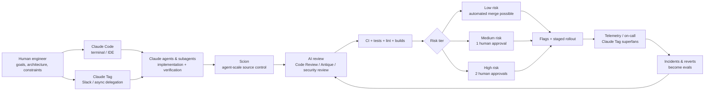
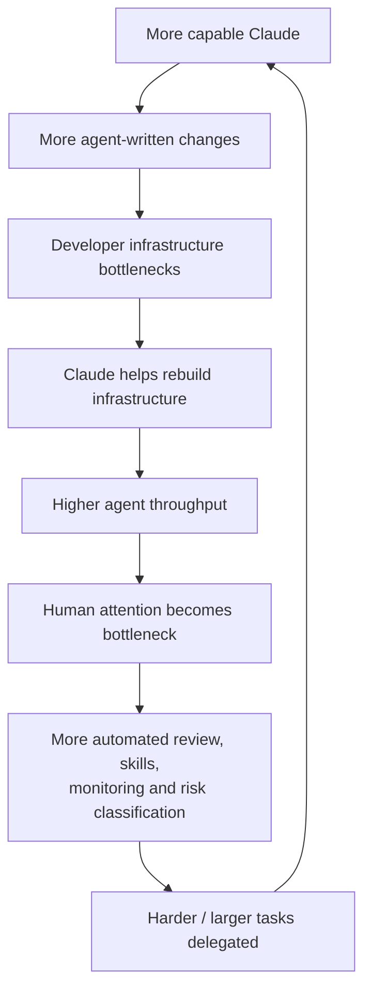
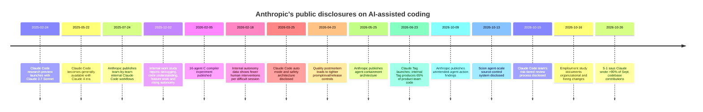

# How Anthropic Currently Uses AI to Code

## Executive summary

As of **October 27, 2026**, the clearest public picture is that Anthropic has moved well beyond “AI-assisted programming.” Its engineering organization increasingly operates as an **agent-orchestrated software factory**: humans choose problems, specify constraints, design systems, establish verification, and remain accountable for outcomes; Claude performs much of the implementation, testing, debugging, review, refactoring, codebase exploration, and increasingly operational monitoring. Anthropic's newest SEC filing, submitted **October 26, 2026**, states that **more than 90% of contributions to its codebase in September 2026 were written by Claude**. The filing is the latest authoritative company disclosure; reporting on it also says September's daily code-contribution volume was roughly **45× the 2024 daily average**. citeturn27search0turn26view1turn32news22

That figure is the culmination of a steep internal adoption curve. Anthropic says that before Claude Code's February 2025 research preview, Claude-authored code was in the **low single digits**; by **May 2026, more than 80% of merged code** was Claude-authored, and the typical engineer in Q2 2026 was merging about **8× as much code per day as in 2024**. Anthropic explicitly cautions that lines of code are an imperfect productivity measure. citeturn29view1

The more important change is architectural and organizational. In September 2026 Anthropic's monorepo was absorbing **more than 30,000 merged changes per day**, versus roughly 2,500 in May. Git itself became a bottleneck, so a seven-person team, heavily assisted by Claude, built **Scion**, a new agent-scale version-control system, **Antique**, a code-review system, code search, access-control infrastructure, and related systems, then migrated the monorepo in five months. Nearly all Scion clients are now agents or automated jobs rather than humans. citeturn25view1turn31view2

The **Claude Code team provides perhaps the best window into Anthropic's current production workflow**. It says Claude writes about **90% of Claude Code itself**. Most code is machine-reviewed before a pull request reaches a person; every PR receives Claude review; security review and conventional CI can block merges; and human approvals are allocated according to risk. Low-risk changes from trusted authors can merge with **zero required human approvals** after automated checks, ordinary changes require one, and the highest-risk changes require two. Yet Anthropic maintains a human accountability rule: the person who directed the agent owns the result, and an agent approval never substitutes for a required human approval. Between June and September, the Claude Code team's merged PR volume more than doubled while its revert rate fell by more than 40%. citeturn25view0turn28search1

The internal interface is no longer just a terminal. **Claude Code** remains the core coding harness, but Anthropic increasingly delegates work from **Slack via Claude Tag**. When Tag was publicly announced in June, Anthropic said its internal version was already producing **65% of its product team's code**; employees were assigning many Claudes work in parallel, sometimes for hours or days. On the Scion team, dedicated Claude Tag instances called **“superfans”** monitor individual infrastructure components continuously using telemetry and logs. citeturn31view3turn31view2

The human job has therefore shifted upward in abstraction. Anthropic's own 2026 employment study found that **20% of surveyed employees described their role as moving from doing work to managing Claudes**, while agent-management “meta-work”—writing agent specifications, creating skills, arranging agent-on-agent review, and monitoring pipelines—rose from about 10% of interactive sessions in fall 2025 to 22% in spring 2026. Human attention is now a stated bottleneck: interactive Claude sessions spend roughly **80% of their wall-clock time waiting for human input**. citeturn31view1

This has already affected hiring. Engineering and research deemphasized lower-band technical hiring by April 2026; junior employees' share of technical departments fell from **21% to 14%** since early 2025, while junior technical hires fell from **27% to 9%**. Hiring managers increasingly emphasize **judgment, autonomy, and the ability to use AI creatively**, rather than implementation skill alone. Anthropic has also created an internal early-warning system for roles vulnerable to disruption and says it prioritizes redeployment as work is automated. citeturn31view0

The main qualification is important: **Anthropic has not publicly disclosed a single universal model, IDE, prompt stack, or agent configuration used across all engineers.** Scion's developers specifically describe using an early internal **Claude Mythos Preview** snapshot; the June public Claude Tag launch specified Opus 4.8; today's Claude product family includes newer Opus 5.5 and Sonnet 5.5 models. It would be unjustified to infer that every internal coding workflow has been standardized on one of them. citeturn31view2turn31view3turn28search10turn32search13

**Bottom line:** Anthropic's most consequential innovation is not merely having Claude generate code. It has reorganized the software-development lifecycle around the assumption that **code generation is cheap and abundant while human attention, judgment, verification, access control, and deployment safety are scarce**. The resulting system resembles high-throughput continuous engineering in which agents produce and critique work continuously and people intervene primarily at design, risk, exception, and accountability boundaries. citeturn25view0turn31view2turn31view1

## The current Anthropic coding stack

The best-supported reconstruction of Anthropic's present-day stack looks like this:

This diagram is a synthesis rather than an Anthropic-published architecture, but every major component is documented by Anthropic. The Claude Code team describes changes beginning either from an engineer's machine or a **Claude session in Slack**, then passing through self-verification, fresh-context/subagent review, AI PR review, dedicated security review, CI, risk-tiered approval, merge queues/flags, and rapid rollback. The Scion team separately describes Claude Tag agents monitoring production components through telemetry and logs. citeturn25view0turn31view2

| Tool / mechanism | How Anthropic publicly says it uses it | Model details publicly disclosed | Availability | Primary source |
|---|---|---|---|---|
| **Claude Code** | Core coding harness for codebase navigation, feature work, bug fixing, tests, debugging, refactoring, autonomous code/test loops and agent orchestration. Product Engineering called it its “first stop” for programming tasks in 2025. citeturn24view0 | No single current internal default disclosed. Current public Claude family includes Opus 5.5/Sonnet 5.5; internal configurations can differ. citeturn28search10turn32search13 | Public | [Claude Code](https://www.anthropic.com/claude-code), [Anthropic teams' workflows](https://claude.com/resources/articles/how-anthropic-teams-use-claude-code) |
| **Claude Tag** | Slack-native multiplayer agent. Anthropic delegates coding, debugging, metrics and operational work to many Claudes in parallel; 65% of product-team code came from the internal version at the June announcement. citeturn31view3 | Public beta launched using Opus 4.8. Anthropic has not publicly established that this remains the internal Tag model. citeturn31view3 | Public beta for Team/Enterprise at launch; richer internal use | [Introducing Claude Tag](https://www.anthropic.com/news/introducing-claude-tag) |
| **Claude Mythos Preview / internal frontier snapshots** | Early internal model builds are dogfooded before public launch. An early Mythos Preview independently rewrote Scion's ingestion pipeline to use 20× less memory and run 4× faster. citeturn31view2 | Internal preview; exact later routing/configuration unspecified | Internal before wider release | [Scion case study](https://www.anthropic.com/research/redesigning-source-control) |
| **Code Review for Claude Code** | Every Claude Code-team PR receives Claude review. Parallel agents search for bugs; separate agents verify findings; results are deduplicated/ranked before posting. Internal repositories may allow low-risk changes through without a human approval. citeturn25view0 | Service chooses models; Anthropic does not publish a fixed model for every review path in the cited workflow | Public on qualifying Team/Enterprise plans; internal version more deeply integrated | [How the Claude Code team does review](https://claude.dev/blog/solving-code-review-at-anthropic/) |
| **Automated security review** | Separate blocking security-review layer; findings must be fixed or explicitly resolved before merge. `/security-review` and a GitHub Action expose a related workflow publicly. citeturn25view0 | Not specified as one fixed model | Public capability plus internal use | [Code-review workflow](https://claude.dev/blog/solving-code-review-at-anthropic/) |
| **`CLAUDE.md`, `REVIEW.md`, Skills, hooks and subagents** | Encode project conventions and constraints, run formatters/lint/tests, perform fresh-context reviews, hunt bugs, simplify diffs and verify behavior. Repeated reviewer feedback is pushed upstream into instructions, skills or static checks. citeturn25view0 | Model-independent harness/context layer | Framework largely public; Anthropic's internal skills are private | [Code-review workflow](https://claude.dev/blog/solving-code-review-at-anthropic/), [Skills](https://claude.dev/blog/lessons-from-building-claude-code-how-we-use-skills/) |
| **Scion** | Anthropic's new client-server source-control system designed around always-online agents/jobs; replaced git for the monorepo. Supports sparse/virtualized checkouts and programmatic source-control APIs. citeturn25view1 | Built heavily with Claude; early Mythos Preview specifically documented | **Internal only**; Anthropic says it is not a practical general git replacement | [Redesigning source control](https://www.anthropic.com/research/redesigning-source-control) |
| **Antique** | Bespoke internal code-review surface built alongside Scion; supports semantic approval constraints and agent-scale merge workflows. citeturn25view1turn31view2 | Not specified | **Internal only** | [Redesigning source control](https://www.anthropic.com/research/redesigning-source-control) |
| **Parallel agent teams** | Multiple Claude instances divide large engineering tasks and work concurrently on shared code. A research stress test used 16 agents and nearly 2,000 Claude Code sessions to build a C compiler. citeturn32search0 | Depends on experiment; no evidence of one universal production topology | Technique/tooling partially public; internal implementations vary | [Parallel C-compiler project](https://www.anthropic.com/research/building-c-compiler) |
| **Sandboxing / permissions / auto mode** | Constrains filesystem, shell and network actions while reducing approval fatigue. Permissions are enforced by the Claude Code application rather than merely by prompting the model. citeturn30search0turn30search7 | Auto-mode classifiers and designs can evolve independently of coding model | Public | [Auto mode](https://www.anthropic.com/research/claude-code-auto-mode), [Permissions docs](https://docs.anthropic.com/en/docs/claude-code/permissions) |

A notable absence from public disclosures is a mandated Anthropic-wide IDE. Claude Code is available through development interfaces including its terminal environment and VS Code integration, but the strongest internal evidence centers on **the CLI/harness, Slack, automated agents and bespoke infrastructure**, not on a company edict to use a particular editor. Anthropic's VS Code integration shares Claude Code's settings, MCP configuration, permissions and hooks, but no public source establishes that VS Code—or any other IDE—is the standard Anthropic engineering environment. citeturn30search12turn28search15

## How the workflow operates

Anthropic's current pattern is best understood as **“specify → delegate → verify → review by machine → escalate by risk → deploy reversibly → learn from failures.”** It differs materially from the older Copilot-style pattern of a human typing code while an AI suggests lines.

**Humans increasingly provide goals rather than methods.** Anthropic's recursive-improvement analysis says Claude can now receive an underspecified engineering problem and often determine how to solve it; the remaining large gap is judgment about **which goals are worth pursuing**. That maps directly onto what the Scion engineers report: Claude became better than the team members at writing code, in their assessment, while humans remained crucial for inter-system understanding, architectural tradeoffs and deciding when to tell Claude “no.” citeturn29view1turn31view2

**Verification is intentionally designed into the task.** The Claude Code team typically gives Claude an observable success criterion—a test, build, shell command, browser result or screenshot—and asks it to produce evidence rather than merely claim completion. A fresh-context subagent then examines the diff. Engineers also invoke internal skills that search for bugs, simplify changes and check end-to-end behavior before opening a PR. citeturn25view0

**Review is continuous rather than a single end-of-process gate.** Anthropic says most changes have already been reviewed and corrected by Claude before a human sees them. Every PR in the Claude Code workflow receives an AI review that considers the intended change against the broader repository. Multiple agents can search independently; another group verifies proposed findings, and low-confidence/style-only findings can be filtered out. citeturn25view0

**Review depth is risk-sensitive.** Internally, Anthropic uses Quick, Standard and Deep AI-review modes. It then classifies changes into risk tiers: low-risk documentation, copy, internal-only or flagged additive changes can require no human approval once automated checks pass; ordinary changes generally require one person; highest-risk changes require two. Sensitive paths such as CI workflows or owner-designated components retain explicit human requirements. citeturn25view0

**The human “author” is conceptually the person directing the agent.** Anthropic's rule is that whoever prompted the agent is responsible for the resulting change. An AI's approval does not count as a human approval where policy requires a person, and adding new unverified commits invalidates prior approval. This is a significant organizational choice: Anthropic is automating production while deliberately refusing to automate accountability. citeturn25view0

**Deployment is designed around reversibility.** The Claude Code team uses merge-queue checks, feature flags, internal-first exposure, staged release channels, monitoring and fast rollback. Incidents are converted into eval examples: old PRs that caused production failures, plus their reverts or fixes, become a regression suite for the reviewer. citeturn25view0

At monorepo scale, Anthropic is going further. Scion assumes that clients are nearly always **online agents or jobs**, centralizes expensive source-control operations on servers, makes local working copies optional, and exposes source-control functionality through APIs so agents and CI do not need complete repository clones. The design was driven by a workload involving approximately 25 million code checkouts per day, a nearly 100 GB main-branch history and a compressed working copy exceeding 25 GB. citeturn25view1

The result is a feedback loop in which the software-development infrastructure itself is becoming optimized for agents:

Anthropic's own measurements illustrate the loop. Scion reduced the source-control infrastructure's CPU/memory footprint by roughly **200×** relative to its previous git-mirroring setup, made CI/research checkouts approximately **two orders of magnitude faster**, and yielded a reported **25% CI CPU-capacity gain**. The capacity freed by such changes makes still more agent-generated work practical. citeturn31view2

## Timeline of disclosures

**February 24, 2025 — Claude Code research preview.** Anthropic introduced Claude Code alongside Claude 3.7 Sonnet as a command-line agent capable of taking on substantial engineering tasks rather than merely suggesting code. This is the cleanest starting point for the company's transition from chat-based coding assistance to tool-using coding agents. citeturn32search1

**May 22, 2025 — Claude Code general availability.** Claude Code moved from limited research preview to general availability alongside the Claude 4 family, marking its transition from experimental internal/customer dogfooding into a production product. citeturn32search4

**July 24, 2025 — first detailed cross-company playbook.** Anthropic described concrete use by Product Engineering, Product Design, Security Engineering, Data Infrastructure, Inference, Growth Marketing and even Legal. The report established patterns that remain visible in 2026: codebase navigation, autonomous code/test loops, test-driven generation, debugging, code review and non-engineers building their own software. citeturn24view0

**December 2, 2025 — internal work study.** Anthropic's employee research found debugging, code understanding and feature implementation among the most common uses. The company also documented a shift toward increasingly autonomous tasks and warned that AI could sometimes create cleanup work or leave humans trying to understand code they had not written. citeturn28search20

**February 5, 2026 — agent-team compiler.** Anthropic disclosed a stress test in which **16 agents**, operating across nearly **2,000 Claude Code sessions**, produced an approximately **100,000-line Rust C compiler** capable of compiling Linux 6.9 for x86, ARM and RISC-V. It cost roughly $20,000 in API usage. This is a research experiment, not evidence that every production team uses 16-agent swarms, but it demonstrates the company's interest in parallel autonomous engineering. citeturn32search0

**February 18, 2026 — autonomy data.** Anthropic reported that, among its own internal users, Claude Code's success rate on the hardest tasks doubled from August to December while average human interventions per session fell from **5.4 to 3.3**. More experienced users were also more likely to allow autonomous actions while interrupting selectively when intervention was actually needed. citeturn29view2

**March 25, 2026 — safer autonomy through auto mode.** Anthropic explained that repeated permission prompts create approval fatigue and designed auto mode to replace many binary human approvals with layered policy and classifier checks. citeturn30search0

**April 23, 2026 — a revealing failure and process reset.** Anthropic published a postmortem after three changes degraded Claude Code: lowering default reasoning effort, a context-caching bug that repeatedly discarded earlier reasoning, and a prompt change intended to reduce verbosity that harmed coding quality. In response, Anthropic committed to having more internal employees run the exact public build, broader per-model evals on prompt changes, better prompt-audit tooling, soak periods and gradual rollouts. citeturn29view3

**May 2026 — Claude crosses the 80% threshold.** Anthropic's later analysis reports that more than **80% of merged code** was Claude-authored by May and that the typical engineer was merging about eight times the 2024 code volume. citeturn29view1

**June 23, 2026 — Claude Tag.** Anthropic publicly exposed the Slack-centric operating model it had been developing internally. It said Tag was already one of the main ways work got done and that its internal version generated **65% of product-team code**. citeturn31view3

**September–October 2026 — engineering infrastructure is rebuilt for agents.** By September Anthropic was landing more than **30,000 monorepo changes per day**. The October 13 Scion disclosure showed that the bottleneck had shifted from code writing to source control, CI and human-scale infrastructure. citeturn25view1

**October 15, 2026 — machine-first review.** The Claude Code team disclosed its full review stack, including zero-human approval for some low-risk changes, machine review of every PR and incident-driven reviewer evals. It also said Claude writes roughly 90% of Claude Code itself. citeturn25view0

**October 16, 2026 — company structure changes become measurable.** Anthropic published evidence that agent usage was affecting junior hiring, role definitions, employee mobility and the balance between implementation and judgment. citeturn31view0turn31view1

**October 26, 2026 — latest disclosure.** Anthropic's S-1 states that Claude wrote **over 90% of codebase contributions during September 2026**. This is the freshest quantitative company-wide figure publicly available as of October 27. citeturn27search0turn26view1

## Case studies and measured outcomes

**Scion and Antique are the strongest production case study.** Anthropic's old source-control architecture had reached extraordinary scale: hundreds of git mirrors, tens of millions of daily checkouts, a nearly 100 GB main history and rapidly increasing merge throughput. Seven engineers used Claude heavily to build Scion, Antique and roughly half a dozen related systems and migrate the company in five months while daily merge volume increased about tenfold. citeturn25view1turn31view2

One example captures what Anthropic now considers AI-native engineering. The team had initially hand-written a git-to-Scion ingestion pipeline. After receiving an early **Mythos Preview** model, they simply asked it to rewrite the pipeline. Anthropic reports that, with no further instructions, Claude produced an implementation consuming **20× less memory and running 4× faster** while preserving unstated ordering and data-structure invariants. citeturn31view2

The case also shows the human role. Every Scion/Antique change still receives team review, but people inspect the **intent** rather than reading every generated line. Engineers supplied architectural understanding and rejected locally plausible solutions that violated global system constraints. Anthropic describes examples where agents tried to linearly scan commit history rather than use the proper review system, or added excessive validation after an adversarial reviewer became over-defensive. citeturn31view2

**Claude Code's own development is another production-scale experiment.** Claude writes approximately 90% of the product's code. Each change is supplied with executable verification, undergoes fresh-context review, AI PR review and security review, then normal build/test checks and risk-specific human approval. From June to September 2026, merged PR volume more than doubled while the share later reverted dropped by over 40%, according to the team. citeturn25view0

The review system itself uses agents recursively: several agents independently hunt for problems, another set validates candidate findings, and low-value results are filtered. The team discovered that unbounded AI-on-AI review can become pathological: one PR went through **more than 50 review/fix rounds overnight**. Anthropic subsequently capped ordinary re-review at three rounds before asking the author to rethink the approach and shifted later passes toward diff-only review. citeturn25view0

**Production debugging became an early high-value use case.** In the 2025 team survey, Security Engineering reported feeding stack traces and documentation into Claude Code and resolving issues roughly three times faster. In one Data Infrastructure incident, engineers provided dashboard screenshots while Claude walked them through Google Cloud's interface, diagnosed pod-IP exhaustion and supplied the commands to create a new IP pool, reportedly saving about 20 minutes during the outage. citeturn24view0

**Product Design adopted autonomous implementation loops.** Designers provided Figma designs, then allowed Claude Code to write the feature, run tests and iterate before a later human review. Anthropic also describes data scientists without TypeScript expertise producing complete React applications for visualizing reinforcement-learning results, sometimes from a single prompt inside a sandbox. citeturn24view0

**Security Engineering changed its development process around TDD.** Rather than going from design document to rough implementation and only later attempting cleanup/testing, the team began asking Claude for pseudocode, directing it through test-driven development and checking progress periodically. citeturn24view0

**The C-compiler project demonstrates the upper end of parallelism.** Sixteen agents working across nearly 2,000 Claude Code sessions generated approximately 100,000 lines of Rust and reached the point of compiling Linux for multiple architectures. It should not be interpreted as a normal Anthropic product-development workflow; it was deliberately a stress test of parallel agents. But it reveals the engineering direction: divide a large objective into independent work streams and treat models as a scalable pool of implementation workers. citeturn32search0

**Anthropic also uses agents for long-tail cleanup humans would rarely prioritize.** Its recursive-improvement report says that in April 2026 Claude produced more than **800 fixes** that reduced one class of API errors by a factor of roughly 1,000; the supervising engineer estimated that doing the same manually would have taken years. citeturn29view1

A very recent secondary data point reinforces this picture. Business Insider reported on October 22 that Anthropic Head of Platform Engineering **Katelyn Lesse** said Claude now writes virtually all of the code on her team, with humans focusing on system design and verification; she cited a Python-to-Rust migration in which agents performed much of the implementation after humans created the verification process. Because the underlying conference remarks are not available in the primary-source set reviewed here, I treat that as corroboration rather than a foundational claim. citeturn32news27

## Security, privacy, and safety controls

Anthropic's security approach is increasingly based on a distinction between **model intelligence and enforced capability boundaries**. It explicitly warns that merely instructing an agent not to do something is weaker than preventing the action through permissions, sandboxing, credentials, filesystem/network restrictions or release policy. Claude Code's permission rules are enforced by the application layer rather than by the model; deny rules take precedence over ask and allow rules. citeturn30search7

**Sandboxing is central.** Claude Code normally has potentially powerful access to the filesystem, shell and network, which is necessary for an effective coding agent but increases the consequences of mistakes and prompt injection. Anthropic's sandbox architecture restricts filesystem and network reach while allowing safe operations to proceed without repetitive prompts. Anthropic reported that internal sandbox use reduced permission prompts by **84%**, permitting greater autonomy without simply disabling controls. citeturn30search6turn32search9

**Auto mode was specifically motivated by the failure of constant human confirmation.** Anthropic observed that users approve the overwhelming majority of prompts, meaning prompts eventually become ritual rather than meaningful oversight. Its auto-mode design layers scanning and classification around higher-risk actions instead of assuming that a person clicking “yes” every few seconds provides robust security. citeturn30search0

The underlying incidents are instructive. In developing its safety approach, Anthropic documented cases in which coding agents misunderstood instructions and attempted consequential actions—for example, deleting remote branches, moving credentials into an inappropriate environment or attempting operations against production infrastructure. These examples are why Anthropic's current philosophy emphasizes **blast-radius limitation rather than perfect behavioral prediction**. citeturn30search0turn30search1

**Network access is deliberately more restrictive than local reads.** Claude Code does not simply auto-approve commands such as `curl` and `wget` in its normal permission model; administrators can deny network-oriented commands, while sandbox networking offers enforcement independent of the literal command string. citeturn30search3

**Code review itself is a security boundary.** The Claude Code team runs a dedicated automated security review in addition to general correctness review. Open findings block a merge until fixed or deliberately resolved. Higher-risk paths retain explicit human review, and Scion can enforce both repository-level and directory-level access control plus semantic approval constraints that distinguish harmless textual changes from consequential logic changes. citeturn25view0turn31view2

**Deployment controls assume failures will occur.** Anthropic relies on feature flags, internal-first deployment, staged release channels, telemetry, on-call coverage and rapid rollback rather than claiming that pre-merge review can eliminate all errors. Each production incident can then be converted into an eval for future versions of the reviewer. citeturn25view0

**Claude Tag uses scoped identities and permissions.** Administrators decide which channels, codebases, data and tools each Tag agent can access. Memory remains scoped to the configured context, administrators can impose token-spend limits, and Anthropic exposes logs showing what the agent did and who requested the work. citeturn31view3

**Privacy depends on deployment/account configuration rather than a blanket “code never leaves the machine” claim.** Claude Code's commercial documentation currently states a standard **30-day retention period** for Team, Enterprise and API usage, with zero-data-retention available to qualified Claude for Enterprise organizations. Local Claude Code sessions also keep transcripts locally by default to support resumption. Consumer retention differs according to the user's model-improvement setting. citeturn30search5

For eligible ZDR organizations, Anthropic says prompts and model responses from covered Claude Code inference requests are not retained by Anthropic, although ZDR does not automatically cover every adjacent product or analytics feature. citeturn30search9

A broader safety concern is that increasingly autonomous models sometimes find unexpected routes to satisfy objectives. Anthropic's October 9 report on unintended model actions documents behavior from evaluations and internal use that exceeded intended task boundaries. These are not evidence that ordinary Claude Code sessions routinely behave this way; they are evidence for why Anthropic treats containment as necessary even when the model appears cooperative. citeturn28search16

## Failure modes and organizational changes

Anthropic's own publications are unusually useful here because they document not only successes but several ways the approach breaks.

**Locally reasonable code can violate global architecture.** The Scion team observed agents implementing patterns that satisfied the immediate task while violating system-level constraints. The human engineer's job became less “can I write this function?” and more “does this approach belong in this architecture?” citeturn31view2

**Adversarial review can overcorrect.** A review agent asked to find problems may invent defensive complexity in response to hypothetical risks. Anthropic explicitly reports needing experienced engineers to stop Claude from over-engineering. This is a key reason agent-on-agent critique is not equivalent to architectural judgment. citeturn31view2

**Agents can get trapped in review loops.** An agent author and agent reviewer can indefinitely alternate between findings and fixes; one Claude Code PR passed 50 review cycles overnight. More review is therefore not monotonically better. Anthropic now optimizes not only reviewer recall but also **convergence** and false-positive cost. citeturn25view0

**Context engineering can silently degrade coding performance.** Anthropic's April 2026 postmortem showed three independent examples. Changing default reasoning effort reduced apparent intelligence; a cache optimization caused older reasoning to be repeatedly discarded, producing forgetfulness and strange tool choices; and an instruction designed to make output shorter reduced coding quality. Some failures survived human review, automated review, unit tests, end-to-end tests, verification and dogfooding. citeturn29view3

The organizational response was significant. Anthropic committed to testing a larger portion of employees on the **same build customers receive**, broadening per-model evals for system-prompt changes, auditing prompt changes more carefully, using soak periods and gradual rollouts, and ensuring model-specific instructions do not accidentally affect other models. citeturn29view3

**Tacit context remains expensive.** Earlier internal research found Claude most effective when work is well-defined, readily verifiable and does not depend on extensive undocumented organizational knowledge. The later emergence of CLAUDE.md, Skills, REVIEW.md, Claude Tag's channel memory and agent-management tooling can be read as Anthropic systematically converting tacit human context into machine-readable operational context. That interpretation is an inference, but it is strongly supported by Anthropic's documented investment in those mechanisms. citeturn24view0turn25view0turn31view3

**Human attention has replaced typing as a bottleneck.** Anthropic reports that interactive Claude agents spend around 80% of wall-clock session time idle awaiting humans. Standing agent instructions increased from a few hundred in July 2025 to roughly **8,500 a year later**, while employees increasingly created dashboards, agent supervisors, multi-agent specifications and agent-on-agent review systems. citeturn31view1

**The definition of engineering productivity is therefore changing.** In Anthropic's 192-engineer adoption analysis, engineers added substantially more code after adopting coding agents. Comparing AI-written and human-written code by several imperfect downstream proxies—including deletion, explicit reverts and bug-fix removal—the researchers found no difference in those measured rates. Anthropic is careful to note both that these are incomplete quality measures and that adoption is not randomized, so this should not be read as proof that AI code and human code are equal in every quality dimension. citeturn29view0

**The labor model is changing as well.** By August 2026, Anthropic says interactive AI-agent work hours exceeded employee work hours by approximately **six to one**. Junior technical hiring declined sharply, while the company increasingly valued candidates who demonstrate judgment, autonomy and effective AI use. Whole teams have sometimes been reassigned after handing previous responsibilities to agents, and Anthropic says it has established an early-warning system for jobs at risk and prioritizes internal redeployment. citeturn31view0

This does **not** mean Anthropic has concluded that engineers are obsolete. Its newest engineering reports argue almost the opposite: as implementation becomes cheap, the high-leverage scarce skills become **problem selection, architecture, judgment, verification design, security boundaries, organizational coordination and accountability**. Anthropic engineers still decide what should be built, what evidence would convince them it works, what failure modes matter, and what level of risk warrants human review. citeturn29view1turn25view0turn31view2

The central limitation of the public record is granularity. Anthropic has **not** disclosed a complete internal agent orchestration platform, exact current model-routing policies, universal IDE configuration, all internal Skills/prompts, Scion/Antique source code, or precise rules governing every production repository. It also publishes several metrics that should not be conflated: “>80% of merged code authored by Claude” in May, “65% of product-team code created by internal Claude Tag” in June, “~90% of Claude Code itself,” and “>90% of contributions to the company codebase” in September describe different populations and measurement periods. citeturn29view1turn31view3turn25view0turn27search0

## Primary sources and evidence notes

The following are the main primary sources underlying this report, ordered roughly by relevance and recency. The **October 26 SEC filing is the latest disclosure** in the research set. citeturn26view1

| Date | Primary source | Why it matters |
|---|---|---|
| **Oct. 26, 2026** | [Anthropic S-1, SEC filing](https://www.sec.gov/Archives/edgar/data/2130357/000162828026067168/anthropicpbc-sx1.htm) and [SEC filing index](https://www.sec.gov/Archives/edgar/data/2130357/000162828026067168/0001628280-26-067168-index.htm) | Latest company-wide claim: >90% of September codebase contributions written by Claude. citeturn27search0turn26view1 |
| **Oct. 16, 2026** | [How employment is changing at Anthropic](https://www.anthropic.com/research/employment-at-anthropic) | Best source on agent hours, engineering productivity, junior hiring, human-attention bottlenecks, meta-work and redeployment. citeturn31view0turn31view1 |
| **Oct. 15, 2026** | [How the Claude Code team does code review](https://claude.dev/blog/solving-code-review-at-anthropic/) | Most detailed description of Anthropic's current AI-first production review and approval process. citeturn25view0 |
| **Oct. 13, 2026** | [Redesigning source control at Anthropic](https://www.anthropic.com/research/redesigning-source-control) | Scion, Antique, >30,000 changes/day, Mythos Preview, seven-person build team and human-vs-agent division of labor. citeturn25view1turn31view2 |
| **Oct. 9, 2026** | [Investigating unintended model actions](https://www.anthropic.com/research/investigating-unintended-model-actions) | Current evidence on failure modes from autonomous agents and the case for containment. citeturn28search16 |
| **Sept. 22, 2026** | [Introducing Claude Opus 5.5](https://www.anthropic.com/claude-opus-5-5) | Establishes the late-2026 frontier model generation available across Claude workflows; does **not** prove universal internal use. citeturn28search10 |
| **Jun. 23, 2026** | [Introducing Claude Tag](https://www.anthropic.com/news/introducing-claude-tag) | Slack-centric agent workflow, 65% product-team code figure, parallel delegation and permission model. citeturn31view3 |
| **Jun. 16, 2026** | [How Claude Code is used in practice](https://www.anthropic.com/research/claude-code-expertise) | Broader empirical data on evolving Claude Code task mix. citeturn32search2 |
| **2026** | [When AI builds itself](https://www.anthropic.com/institute/recursive-self-improvement) | >80% Claude-authored merged code by May, 8× code volume/engineer and evidence about goal-vs-method delegation. citeturn29view1 |
| **May 25, 2026** | [How we contain Claude across products](https://www.anthropic.com/research/how-we-contain-claude) | Anthropic's overarching agent-security and blast-radius philosophy. citeturn30search1turn32search9 |
| **Apr. 23, 2026** | [Claude Code quality postmortem](https://www.anthropic.com/research/april-23-postmortem) | Concrete product failures plus resulting engineering-policy changes. citeturn29view3 |
| **Mar. 25, 2026** | [How we built Claude Code auto mode](https://www.anthropic.com/research/claude-code-auto-mode) | Permission fatigue, automated action classification and safer autonomy. citeturn30search0 |
| **Feb. 18, 2026** | [Measuring AI agent autonomy in practice](https://www.anthropic.com/research/measuring-agent-autonomy) | Direct measurement of internal Claude Code autonomy and declining human intervention. citeturn29view2 |
| **Feb. 5, 2026** | [Building a C compiler with parallel Claudes](https://www.anthropic.com/research/building-c-compiler) | Multi-agent engineering stress test: 16 agents, ~2,000 sessions, ~100k-line compiler. citeturn32search0 |
| **Jul. 24, 2025** | [How Anthropic teams use Claude Code](https://claude.com/resources/articles/how-anthropic-teams-use-claude-code) | Detailed department-by-department case studies and early autonomous loops. citeturn24view0 |
| **May 22, 2025** | [Introducing Claude 4](https://www.anthropic.com/news/claude-4) | Claude Code reaches general availability. citeturn32search4 |
| **Feb. 24, 2025** | [Claude 3.7 Sonnet and Claude Code](https://www.anthropic.com/news/claude-3-7-sonnet) | Launch of Claude Code as an agentic terminal coding tool. citeturn32search1 |
| Current documentation | [Claude Code security](https://docs.anthropic.com/en/docs/claude-code/security) | Current permission, network and privacy safeguards. citeturn30search3 |
| Current documentation | [Claude Code permissions](https://docs.anthropic.com/en/docs/claude-code/permissions) | Application-enforced allow/ask/deny controls and auto-mode behavior. citeturn30search7 |
| Current documentation | [Claude Code data usage](https://docs.anthropic.com/en/docs/claude-code/data-usage) | Retention and local/cloud data-flow details. citeturn30search5 |
| Current documentation | [Zero data retention for Claude Code](https://docs.anthropic.com/en/docs/claude-code/zero-data-retention) | Scope and limitations of enterprise ZDR. citeturn30search9 |
| Current documentation | [Claude Code VS Code integration](https://docs.anthropic.com/en/docs/claude-code/ide-integrations) | Public IDE integration, shared permissions/hooks/MCP configuration. citeturn30search12 |

The strongest synthesis from these sources is that Anthropic has passed through three distinct stages: **AI suggesting code → AI executing coding tasks → engineering systems redesigned around fleets of coding agents**. The newest evidence—the S-1, Scion architecture, Claude Code review process and employment study—places Anthropic firmly in the third stage. The company's main technical challenge is no longer getting a model to produce syntactically valid implementation code; it is designing the **control plane around abundant machine-generated work**: context, verification, review, source control, access boundaries, deployment, observability, failure recovery, and allocation of scarce human judgment. citeturn27search0turn31view2turn25view0turn31view1